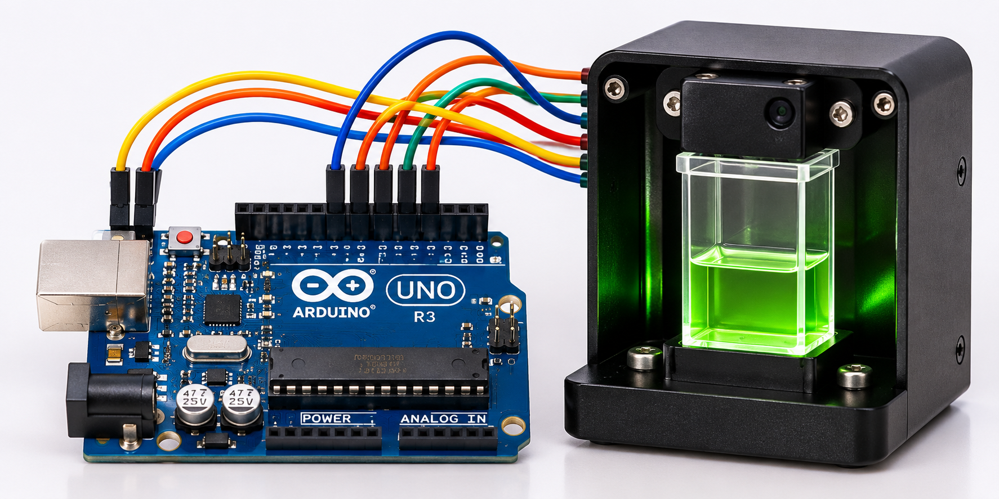

# AI-Driven Glucose Monitoring System

### Multi-Wavelength Optical Sensing | Machine Learning | Telemedicine

A biomedical engineering research project investigating glucose concentration estimation using multi-wavelength optical measurements, Arduino-based data acquisition, and Random Forest regression.

<p align="center">
  
</p>

<p align="center">
  <em>Conceptual visualization of the proposed optical sensing hardware.</em>
</p>

<p align="center">
  <a href="https://sejuti-dhali.github.io/Glucose-Monitoring-System/">
    <strong>Project Website</strong>
  </a>
  &nbsp; | &nbsp;
  <a href="https://github.com/Sejuti-Dhali/Glucose-Monitoring-System">
    <strong>GitHub Repository</strong>
  </a>
</p>

---

## Project Overview

This project investigates a multi-wavelength optical sensing approach for glucose concentration estimation. The proposed system integrates an optical measurement chamber, Arduino UNO-based signal acquisition, machine-learning prediction, and a telemedicine-oriented monitoring interface.

The original research examined prepared glucose solutions using glucose oxidase–peroxidase (GOD–POD) colorimetric chemistry.

The repository additionally provides reconstructed reference code, simulated sensor readings, and a local software demonstration.

## Research Objectives

- Investigate optical responses associated with glucose concentration.
- Examine six visible-wavelength sensing channels.
- Estimate glucose concentration using Random Forest regression.
- Evaluate prediction accuracy and model explainability.
- Demonstrate a telemedicine-oriented monitoring workflow.

## System Architecture

```text
Prepared Glucose Solution
          |
          v
Multi-Wavelength Optical Sensing
          |
          v
Phototransistor Signal Acquisition
          |
          v
       Arduino UNO
          |
          v
Data Processing and Feature Extraction
          |
          v
Random Forest Glucose Prediction
          |
          v
Monitoring and Visualization Interface
```

The original project report also describes HC-05 Bluetooth communication and an Android application named OpTose.

## Optical Sensing Configuration

The proposed system uses six visible-wavelength channels:

| Channel | Wavelength |
|---|---|
| 1 | 420 nm |
| 2 | 460 nm |
| 3 | 520 nm |
| 4 | 570 nm |
| 5 | 610 nm |
| 6 | 630 nm |

The original experimental methodology describes prepared glucose solutions spanning **50–250 mg/dL**.

These measurements concern prepared solutions, not validated non-invasive measurements from human tissue.

## Machine Learning Methodology

The original study describes a Random Forest regression model with the following configuration:

| Parameter | Configuration |
|---|---|
| Algorithm | Random Forest Regressor |
| Estimators | 150 |
| Maximum depth | 8 |
| Training/testing split | 80% / 20% |
| Cross-validation | Fivefold |
| Explainability | SHAP |

### Results Reported in the Original Study

| Metric | Reported Value |
|---|---|
| Test R-squared | 0.960 |
| Test RMSE | 12.511 mg/dL |
| Cross-validation R-squared | 0.928 |

The 520 nm channel was identified as an influential predictor in the reported analysis.

**Important:** These results originate from the original research report. They are not independently reproduced using the repository's synthetic demonstration dataset.

## Software Demonstration

The reconstructed implementation includes:

- Arduino reference firmware.
- Synthetic optical sensor data generation.
- Data preprocessing and Random Forest training.
- Prediction and model evaluation.
- Feature importance and SHAP analysis.
- Local Python prediction API.
- Simulated sensor endpoint.
- Browser-based project website.

The synthetic data and reconstructed code are provided for demonstration and reproducibility of the software workflow; they are not the original experimental measurements or source implementation.

## Repository Structure

```text
Glucose-Monitoring-System/
|
|-- index.html
|-- overview.html
|-- architecture.html
|-- sensing.html
|-- results.html
|-- prototype.html
|-- style.css
|
|-- media/
|   |-- glucose-hardware-cover.png
|   `-- results/
|
|-- data/
|-- docs/
|-- hardware/
|
`-- software/
    |-- arduino/
    |   `-- glucose_sensor.ino
    |
    |-- android/
    |   |-- MainActivity.kt
    |   `-- activity_main.xml
    |
    |-- machine_learning/
    |   |-- requirements.txt
    |   |-- generate_demo_data.py
    |   |-- data_preprocessing.py
    |   |-- train_model.py
    |   |-- shap_analysis.py
    |   `-- predict.py
    |
    `-- backend/
        |-- app.py
        `-- test_integration.py
```

## Installation

Clone the repository:

```bash
git clone https://github.com/Sejuti-Dhali/Glucose-Monitoring-System.git
cd Glucose-Monitoring-System
```

Create a Python virtual environment:

```bash
python -m venv .venv
```

Activate it on Windows PowerShell:

```powershell
.\.venv\Scripts\Activate.ps1
```

Install the required dependencies:

```bash
python -m pip install -r software/machine_learning/requirements.txt
```

## Run the Local Prototype

Start the Python backend:

```bash
python software/backend/app.py
```

Open the local interface:

**http://127.0.0.1:8765/**

The Python prediction API operates locally. GitHub Pages hosts the static website and does not execute the Python backend.

## Integration Testing

Run:

```bash
python software/backend/test_integration.py
```

The most recently verified integration test execution produced:

| Test | Result |
|---|---|
| Health endpoint | PASS |
| Homepage | PASS |
| Prediction endpoint | PASS |
| Simulated sensor endpoint | PASS |

**Total: 4 tests passed.**

## Project Website

The website contains six sections:

1. **Home** — Hardware illustration and navigation.
2. **Overview** — Research motivation and methodology.
3. **Architecture** — System design and processing workflow.
4. **Optical Sensing** — Wavelengths and sensing configuration.
5. **ML Results** — Prediction analysis and explainability.
6. **Interactive Prototype** — Software demonstration interface.

**Website:** https://sejuti-dhali.github.io/Glucose-Monitoring-System/

## Implementation Status and Limitations

| Component | Status |
|---|---|
| Research methodology | Documented |
| Multi-page website | Implemented locally |
| Hardware illustration | Integrated |
| Synthetic ML demonstration | Reconstructed |
| Python backend | Integration-tested |
| Physical optical sensing hardware | Not independently verified |
| Bluetooth hardware communication | Not independently verified |
| Native Android application | Not independently verified |
| Clinical validation | Not performed |

The conceptual hardware illustration does not represent photographic evidence of a validated physical prototype.

The reconstructed Android files are reference components, not a verified, buildable Android application.

## Future Work

- Reproduce model evaluation using original experimental measurements.
- Validate the optical sensing apparatus experimentally.
- Complete hardware-to-software communication.
- Develop and test a complete Android application.
- Evaluate robustness, calibration, and generalization.
- Conduct appropriate independent validation before considering any medical application.

## Disclaimer

**This project is intended for academic research and software demonstration only. It is not a clinically validated glucose monitoring device and must not be used for diagnosis, treatment, insulin dosing, or medical decision-making.**

---

**Biomedical Engineering | Optical Sensing | Machine Learning | Telemedicine**

**Repository:** https://github.com/Sejuti-Dhali/Glucose-Monitoring-System


## Premium Biophilic Website Design

**Visual direction:** Precision Biomedical Analytics

The website uses a nature-inspired design system
with refined typography, organic shapes, responsive
layouts, subtle motion, and accessible interaction
states.

### Design Tokens

| Role | Value |
|---|---|
| Primary | `#34483C` |
| Secondary | `#829681` |
| Accent | `#B69A72` |
| Surface | `#FAF7F0` |
| Pale | `#E9EDE1` |

### Enhancement Architecture

- `biophilic-premium.css`: Independent visual layer
- `biophilic-premium.js`: Progressive UI enhancement
- Existing application files: Preserved

The design enhancement does not introduce a backend,
clinical diagnosis, authentication, or hardware
integration. Existing project limitations still apply.

### Accessibility

The enhancement includes keyboard focus indicators,
responsive typography, and reduced-motion support.
